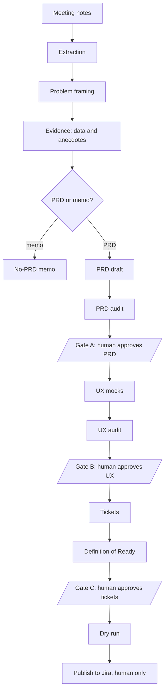

# Agentic PM Workflow

This tool turns meeting notes into an audited PRD (or an honest "no PRD yet" memo), then UX mocks, then Jira tickets. Scripts check the facts at every step, models draft and review, and a human approves at three gates.

## Flow



## Quickstart

```bash
make setup    # create .venv and install dependencies (Python 3.9+)
make test     # run the test suite
make eval     # check every fixture end to end against its expected result
```

Tip: the test suite takes a couple of minutes. On a laptop, run `caffeinate -i make test` so the machine does not sleep.

Then, in Claude Code, run the demo notes through the whole flow:

```
/pm-run fixtures/clean-meeting/notes.md
```

`/pm-run` does intake, extraction, problem framing, evidence, the PRD, validation and the audit. It then stops at each gate:

1. **Gate A (PRD).** It shows a one-screen summary. You run `/pm-approve prd <run-id>`, then `/pm-run <run-id>` again.
2. **Gate B (UX).** It designs and audits the screens and shows a summary. You run `/pm-approve ux <run-id>`, then `/pm-run <run-id>` again.
3. **Gate C (tickets).** It plans the tickets, checks the Definition of Ready and shows a summary. You read `tickets.preview.md`, run `/pm-approve tickets <run-id>`, then `/pm-run <run-id>` again. It then writes the dry-run payloads and stops. Nothing is sent to Jira.

`/pm-run` never approves and never publishes. If the notes give no evidence for the main problem, the run ends with a no-PRD memo instead of a PRD. To write a PRD anyway, give a reason: `.venv/bin/python scripts/prd_decision.py runs/<run-id> --force-prd "<reason>"`.

## Commands

Skills live in `.claude/skills/`.

| Command | What it does |
|---------|--------------|
| `/pm-run <notes path or run-id>` | Drives the whole flow and stops at each gate. |
| `/pm-status [run-id]` | Shows stage, verdicts, approvals, cost and the next command. Changes nothing. |
| `/pm-prd <path-or-paste>` | Stage 1: intake to PRD (or memo), audit, stops at Gate A. |
| `/pm-audit prd <run-id>` | Audits an existing or hand-written PRD. |
| `/pm-enrich <run-id>` | Pulls numbers from a data provider into evidence cards. |
| `/pm-anecdotes <run-id>` | Pulls and curates customer quotes. |
| `/pm-ux <run-id>` | Stage 2: UX from an approved PRD, audit, stops at Gate B. |
| `/pm-audit ux <run-id>` | Audits an existing `ux/` folder. |
| `/pm-tickets <run-id>` | Stage 3: tickets from an approved UX, stops at Gate C, then the dry run. |
| `/pm-approve prd\|ux\|tickets <run-id>` | Human only. Approves a gate, tied to the file hashes. Tickets have no override. |
| `/pm-publish <run-id>` | Human only. Dry run, then a live Jira publish when the config allows it. |

## What is enforced by scripts, and what is an early warning

The controls are the scripts:

- `approve.py` recomputes the verdict from the audit file at approval time. It does not trust `state.json`.
- `check_approval.py` checks that an approval still matches the current files. Editing the PRD, UX or manifest after approval makes it stale.
- `jira_publish.py` re-checks the approval and the Definition of Ready before it does anything, and needs both `jira.mode: publish` and `--publish` to write.
- The validators (`validate_extraction.py`, `validate_problem.py`, `validate_prd.py`, `validate_memo.py`, `validate_evidence.py`, `validate_anecdotes.py`, `validate_ux.py`, `validate_tickets.py`) check structure, citations and number tracing. Verdicts come from `render_audit.py` and `render_ux_audit.py`, never from a model.
- The mock warehouse enforces read-only, aggregate-only queries with a database authorizer.
- The cost check (`cost_meter.py check`) is a script the skills call before each subagent.

The hooks in `.claude/hooks/` are early warnings. They stop the model early and explain why, but the scripts do not depend on them:

- `guard_approvals.py` (before Write/Edit): blocks writes under `runs/*/approvals/`.
- `guard_stage_gate.py` (before Write/Edit): blocks `ux/` writes unless the PRD approval is valid, and `tickets.*` writes unless the UX approval is valid. It allows the write if it cannot run its check.
- `guard_jira_write.py` (before Bash and `mcp__*`): blocks Jira write tools and direct HTTP calls to a Jira site, blocks `jira_publish.py` without a valid tickets approval, and asks for confirmation on `--publish`.
- `guard_readonly_query.py` (before Bash and `mcp__*`): blocks mutating or non-aggregate SQL.
- `validate_artifact.py` and `pii_scan.py` (after Write/Edit): run the PRD validator and the PII scan on the files they cover.
- `cost_meter_hook.py` (SubagentStop): logs the cost of each subagent and warns.
- `load_context.py` (SessionStart), `checkpoint.py` (PreCompact) and `close_out.py` (Stop): put the active run's status in context, write `checkpoint.md` and record status snapshots in `session.log.jsonl`.

Every approval command also triggers a confirmation prompt in Claude Code, so a human accepts each approval.

## Agents

Model tiers come from `pm.config.yaml` (`small` is haiku, `medium` is sonnet, `large` is opus).

| Agent | Tier | Tools | Job |
|-------|------|-------|-----|
| `notes-extractor` | small | Read, Write | Extracts items from numbered notes into `01-extraction.json`. |
| `prd-writer` | large | Read, Write, Edit | Problem framing, PRD draft, PRD revision and the no-PRD memo. |
| `prd-auditor` | medium | Read | Scores the PRD and returns audit JSON only. |
| `data-enricher` | medium | Read, Bash | Picks library queries and runs `enrich.py`. Never writes cards. |
| `anecdote-curator` | small | Read, Write | Keeps 3 to 5 scrubbed quotes, copied unchanged. |
| `ux-designer` | medium | Read, Write, Edit, Bash | Designs and revises the UX folder. |
| `ux-auditor` | medium | Read | Scores the UX and returns audit JSON only. |
| `ticket-architect` | medium | Read, Write, Bash | Plans and revises the ticket manifest. |
| `jira-publisher` | small | Read, Bash | Runs `jira_publish.py` for a live publish. |

## Cost and status

Each subagent run is logged to `runs/<id>/cost.log.jsonl` by a SubagentStop hook. Hooks receive no token counts, so the cost is an estimate: the meter reads the subagent transcript, sums the tokens and prices them with the `pricing` block in `pm.config.yaml`. Those prices are examples. Edit them to your contract prices. If a transcript cannot be read, the entry is logged with null values and nothing is guessed. The main session's own cost is not counted.

Budgets are per stage (`budgets.stage1`, `stage2`, `stage3`). At `budgets.warn_at_percent` the check prints a `WARN:` line. At 100 percent it prints `STOP:` and exits 1, and the skills do not launch another subagent. To continue, raise the budget in `pm.config.yaml`.

```bash
.venv/bin/python scripts/cost_meter.py summary runs/<run-id>   # spent, budget and percent per stage
.venv/bin/python scripts/status.py runs/<run-id>               # full status and next command
```

`/pm-status [run-id]` shows the same status for the active run or a given run.

## What each stage checks

**Stage 1: extraction, problem, PRD.** Intake numbers every line of the notes so each claim can cite a line. `scripts/validate_extraction.py` and `validate_problem.py` check citations and the AI-verdict logic. `prd_decision.py` says MEMO when the main problem is unvalidated and the run has no evidence card and no anecdote for it; the memo (`no-prd-memo.md`) is checked by `validate_memo.py`. `validate_prd.py` checks structure, IDs, citations and number tracing, and `render_audit.py` turns `prd.audit.json` into a verdict. A FAIL goes through up to `audit.max_revision_loops` revisions, then escalates to the human.

**Stage 2: UX.** `/pm-ux` writes `runs/<run-id>/ux/`: `flows.md` (mermaid diagrams), `screens/SCR-###-<name>.html` (one clickable mock per screen with every required state, plus five extra states for an AI feature), `index.html` and `spec.md`. `scripts/validate_ux.py` checks required states, that every Must requirement maps to a screen, self-contained files, design tokens only, labels and alt text, and that index and spec match the screens. The `ux-auditor` judges coverage, AI trust, accessibility and copy clarity. If the script finds errors, the verdict is FAIL whatever the auditor scored. Gate B writes `traceability.md` (REQ to screens).

**Stage 3: tickets.** `/pm-tickets` writes `tickets.manifest.json`: Epics, Stories, Tasks and Spikes, never Sub-tasks and never story points. The Definition of Ready (`scripts/validate_tickets.py`, no model) checks schema, ids and labels, summary format (`[Area] Verb object`, at most 80 characters), no TODO or TBD, at least 3 Given/When/Then criteria per Story, REQ and screen links that exist, analytics events from the spec, AI quality criteria when the PRD has an AI addendum, one instrumentation Task per feature Epic, one Measure and Quality Epic, every Must requirement covered, no `blocks` cycle, and every `jira_key` null before publishing. `scripts/preview_tickets.py` writes `tickets.preview.md`. After Gate C, `scripts/jira_publish.py runs/<run-id>` writes `tickets.dryrun.json`, the exact Jira payloads. The dry run sends nothing to Jira. Changing only a `jira_key` does not make the approval stale.

## Evidence plug-ins: data and anecdotes

Numbers and quotes come from scripts, never from a model. Evidence cards (`runs/<id>/03-evidence/EV-###.json`) are written only by `scripts/enrich.py` from provider output. Anecdotes are copied unchanged from scrubbed candidates.

Commands (skills in `.claude/skills/`):

- `/pm-enrich <run-id> [--registry path] [--config path]`: agent `data-enricher` asks 2 to 5 data questions per problem, picks library queries and runs `enrich.py`; then `validate_evidence.py` checks the cards. Stops with "no data provider configured" if none is enabled.
- `/pm-anecdotes <run-id> [--keywords "a,b"]`: `anecdotes.py pull` writes `04-anecdotes.candidates.json`, agent `anecdote-curator` keeps 3 to 5 (with a counter-anecdote when one exists), `validate_anecdotes.py` checks them.
- `/pm-prd` and `/pm-run` run both in parallel when the registry has enabled providers.

The `--claim` is a template, not a sentence with numbers. The script fills `{value}` (the provider value), `{value_pct}` (value x 100, written as `{value_pct}%` or `{value_pct} percent`, only for fractions 0 to 1) and `{n}` from the provider output, and refuses a template with its own digits, unknown placeholders or a magnitude word (k, m, mn, mm, bn, x, hundred, thousand, million, billion, times) after a number. `validate_evidence.py` re-checks every number in a claim with the same rules, and checks that `query_hash` is the sha256 of the library `.sql` file text and that `source` is the query's provider. Parameter names, formats, allowed values and a working `example` for each library query are in `connectors/queries/index.yaml`.

Offline demo (no real connections): the real `connectors/registry.yaml` stays all-disabled. A separate mock registry enables a fake warehouse and a fake anecdote source:

```bash
.venv/bin/python scripts/enrich.py run runs/<run-id> --provider mock_warehouse --query-id median_minutes_to_confirm \
  --params '{"segment": "smb"}' --question "How long does confirming take for smb?" \
  --claim "Median time to confirm is {value} minutes (n={n})" --supports PB-1 --segment smb \
  --registry fixtures/registry.mock.yaml --config fixtures/pm.config.mock.yaml
.venv/bin/python scripts/anecdotes.py pull runs/<run-id> --provider mock_anecdotes --problem PB-1 --keywords "scheduling,confirm" \
  --registry fixtures/registry.mock.yaml --config fixtures/pm.config.mock.yaml
```

Read-only guard: `scripts/sql_guard.py` allows only a single `SELECT` / `WITH ... SELECT`, rejects INSERT, UPDATE, DELETE, MERGE, DROP, ALTER, CREATE, GRANT, TRUNCATE, REPLACE, ATTACH and PRAGMA, `SELECT *` on `data.pii_tables`, non-aggregate queries (when `data.aggregate_only` is true: at least one aggregate call is needed, `GROUP BY` alone does not count; window functions, `group_concat` and `string_agg` are rejected), `[bracket]` identifiers, and any `LIMIT` that is not `LIMIT <integer>` or `LIMIT <integer> OFFSET <integer>` with the integer at most `data.max_rows_returned`. A query that touches a PII table may only select `COUNT(...)` expressions or literals and may not use `GROUP BY`, `MIN`, `MAX`, `SUM`, `AVG`, `group_concat` or `string_agg`; reviewed library queries that need to group by something must avoid the PII table. The same checks run in three places as an early warning: the guard function, the provider (before it executes) and the hook `guard_readonly_query.py` (before Bash and `mcp__*` calls). They are not the control; see the next paragraph.

What enforces read-only and PII rules: the provider does. The mock warehouse installs a sqlite authorizer that allows only reads, refuses every column of a table listed in `data.pii_tables` and refuses the schema tables and any function not on its allowlist. For a real warehouse, use a read-only database role and PII-free views, and list the PII tables in `data.pii_tables`. The text guard and the hook are early warnings only: they catch honest mistakes but cannot understand every spelling of SQL. Known limits: a row count of a PII table (`COUNT(*)`) is allowed; and a hand-written evidence card with a copied query hash would still validate, so that guarantee rests on the agents' tool limits (the enricher has no Write tool). The cache key includes the sha256 of the query text, so an edited library query is never served a stale result, and outputs whose value is not a number are never cached.

PII scan: `scripts/pii.py` scrubs and scans for emails, phone numbers, URLs with user info and the names listed under `anecdotes.pii_terms` in the config. `anecdotes.py pull` drops records without consent and fails if PII remains. The hook `pii_scan.py` (after Write/Edit) scans `04-anecdotes.json`, `04-anecdotes.candidates.json` and `prd.md`. Manual check: `.venv/bin/python scripts/pii.py scan <file>`.

PRD rule: any quoted passage of 4 or more words in section 6b must appear in an anecdote record or an extraction item.

## Add a data provider in under 10 minutes

1. Write a script that reads the request JSON on stdin and prints the output JSON on stdout (shapes from `schemas/provider-io.schema.json`).

   Request:
   ```json
   {"question": "How long does confirming take?", "query_id": "median_minutes_to_confirm", "params": {"segment": "smb"}}
   ```
   Output (`ok`, `rows`, `n`, `run_at`, `query_hash`, `caveats` are required; `error` is required when `ok` is false):
   ```json
   {"ok": true, "rows": [{"median_minutes": 62.0, "n_meetings": 94}], "n": 1, "run_at": "2026-10-03T11:00:00+00:00", "query_hash": "<sha256>", "caveats": ["what to keep in mind"]}
   ```
   Skeleton (`connectors/providers/my_source.py`). It hashes the SQL text of the library query (the same text `validate_evidence.py` hashes), and `run_query` here is a tiny demo you replace with your read-only code:
   ```python
   import os, sys, json, hashlib, sqlite3
   from datetime import datetime, timezone

   import yaml

   def load_sql(query_id):
       queries_dir = os.environ.get("PM_QUERIES_DIR", "connectors/queries")  # set by enrich.py
       with open(os.path.join(queries_dir, "index.yaml")) as f:
           for q in yaml.safe_load(f)["queries"]:
               if q["id"] == query_id:
                   with open(os.path.join(queries_dir, q["file"])) as g:
                       return g.read()
       raise ValueError(f"unknown query_id '{query_id}'")

   def run_query(sql, params):  # demo only: replace with your read-only, aggregate-only code
       db = sqlite3.connect(":memory:")
       db.execute("CREATE TABLE demo (value INTEGER)")
       db.executemany("INSERT INTO demo VALUES (?)", [(i,) for i in range(1, 11)])
       cur = db.execute(sql, params)
       names = [d[0] for d in cur.description]
       return [dict(zip(names, row)) for row in cur.fetchall()]

   def main():
       req = json.load(sys.stdin)
       out = {"ok": False, "rows": [], "n": 0, "query_hash": ""}
       try:
           sql = load_sql(req["query_id"])
           out["query_hash"] = hashlib.sha256(sql.encode("utf-8")).hexdigest()
           rows = run_query(sql, req["params"])
           if not rows or next(iter(rows[0].values())) is None:
               out["error"] = "query returned no rows for these params"
           else:
               out.update(ok=True, rows=rows, n=len(rows))
       except Exception as e:  # refuse, never crash
           out["error"] = str(e)
       out.update(run_at=datetime.now(timezone.utc).isoformat(), caveats=[])
       print(json.dumps(out))

   if __name__ == "__main__":
       main()
   ```
2. Register it in `connectors/registry.yaml` (set `enabled: true` only when it is real and approved):
   ```yaml
   - id: my_source
     kind: script
     enabled: true
     command: "python connectors/providers/my_source.py"
     capabilities:
       - sql_readonly
   ```
3. Add a query to `connectors/queries/index.yaml` (use a new id), with its `.sql` file next to it (here `connectors/queries/demo_rows_above.sql`: `SELECT COUNT(*) AS n_rows FROM demo WHERE value > :min_value`). Each param is an object with `name`, `description` and either `format` or `allowed_values`; add an `example` request that returns rows. Set `status: reviewed` only after a person has checked the metric definition:
   ```yaml
   - id: demo_rows_above
     provider: my_source
     file: demo_rows_above.sql
     description: Number of demo rows above a threshold
     metric: demo_rows_above
     metric_definition: Count of demo rows whose value is greater than min_value
     params:
       - name: min_value
         description: Rows with a value above this are counted
         format: integer from 1 to 10
     example:
       question: How many demo rows are above 3?
       params: {min_value: 3}
     value_field: n_rows
     n_field: n_rows
     status: reviewed
   ```
4. Test it. Pipe a request into the script:
   ```bash
   echo '{"question": "q", "query_id": "demo_rows_above", "params": {"min_value": 3}}' | .venv/bin/python connectors/providers/my_source.py
   ```
   Then run `enrich.py` against a run (it needs `02-problem.md`) and validate:
   ```bash
   .venv/bin/python scripts/enrich.py run runs/<run-id> --provider my_source --query-id demo_rows_above \
     --params '{"min_value": 3}' --question "How many demo rows are above 3?" \
     --claim "{value} demo rows are above the threshold" --supports PB-1
   .venv/bin/python scripts/validate_evidence.py runs/<run-id>
   ```

## Going live with Jira

Not tested against a real Jira site. The publish path was proven against an in-memory fake Jira that mimics the Jira Cloud REST calls it uses. The first real publish must be run by a human on a test project.

Setup:

1. In `pm.config.yaml` set `jira.mode: publish`, `jira.site` (an `https://` URL, for example `https://yourcompany.atlassian.net`) and `jira.project_key`. Optionally set `jira.issue_types` to map ticket kinds to your Jira issue type names (default: Epic, Story, Task, and Spike becomes Task).
2. Export your credentials in the shell: `JIRA_EMAIL` and `JIRA_API_TOKEN`. They are read only from the environment, never stored in the repo, never printed and never written to a log.
3. Use a test project first.
4. Run `/pm-publish <run-id>`. It checks the tickets approval, does a dry run, and then publishes. Claude Code shows a confirmation prompt that you must accept.

Two keys are needed to publish: `jira.mode: publish` in the config and the `--publish` flag. With either one missing, the script refuses and explains why. Only `scripts/jira_publish.py` writes to Jira (over REST, standard library only); Jira MCP write tools stay blocked.

What idempotent means here: every ticket carries a label `ext-<slug>-<id>`. Before creating a ticket the script searches Jira for that label. If it finds none, it creates the ticket. If it finds one, it updates it instead. So running a publish again never creates duplicates. If two Jira issues carry the same label, the script stops and names them.

Resuming after a failure: epics are written first, then the other tickets in manifest order, and each Jira key is saved as soon as it exists. If a request fails, fix the cause and run `/pm-publish <run-id>` again. Keys already written are kept and the rerun only creates what is missing.

What gets written back to the run: the Jira keys in `tickets.manifest.json`, `state.json` (`jira_keys`, and stage `done`), a log in `tickets.published.json`, and `traceability.md`. Changing only the keys does not make the tickets approval stale. `prd.md`, `ux/` and the approval files are not touched.

Not done: issue links for `blocks` are not created (blocking tickets are listed in the description), and Jira issues removed from the manifest are not deleted.

## Evaluation and fixtures

`make eval` (`scripts/eval_fixtures.py`) builds a temporary run for every folder under `fixtures/` that has `notes.md` and `expected.yaml`. It copies the golden outputs, runs every validator whose input exists, computes the PRD or memo decision and the audit verdicts, and compares them with `expected.yaml`. It prints one row per fixture and `EVAL: <n> fixtures, <m> failed`, and exits 1 if any check fails. Fixtures are synthetic.

| Fixture | What it proves |
|---------|----------------|
| `clean-meeting` | The happy path: clear notes, one validated problem, a PRD that passes with risk. |
| `clean-meeting-evidence` | A PRD that cites script-produced evidence cards and anecdotes, with every number and quote tracing. |
| `ai-clear-fit` | A justified AI feature: the AI gates pass and the PRD carries the AI addendum. |
| `messy-transcript` | Several problems in noisy notes: one primary problem, the others parked. |
| `contradictory-decisions` | Disagreements in the notes: open questions are raised, and the PRD audit FAILs. |
| `solution-first-chatbot` | Notes that start from a solution: it is reframed as an unvalidated problem, and the outcome is a no-PRD memo. |
| `thin-evidence` | A problem with little evidence: the default outcome is a memo, and the PRD written anyway FAILs its audit. |

`fixtures/bad-prd/` is a deliberately broken PRD that the validator must reject.

## Limits

- No screenshots. The UX auditor reads the HTML, and scripts check the facts.
- Never run against a real Jira. The publish path was only proven against an in-memory fake. The first live publish must be a human run on a test project.
- Cost is an estimate from transcripts and example prices, not a bill, and it leaves out the main session.
- The checkers judge form, not substance. They confirm that numbers trace, citations exist and sections are complete. They cannot tell whether the PRD is a good idea, so the human gates matter.
- The mock warehouse and anecdote data are synthetic.

## Key files

- `CLAUDE.md`: principles and repo layout.
- `decisions.md`: local decision log. `scripts/approve.py` appends every approval to it. It is created on first use and is not committed.
- `pm.config.yaml`: configuration, model tiers, budgets and example prices.
- `connectors/registry.yaml`: registry of data sources (all disabled).
- `schemas/`: JSON Schemas for the handoff files.
- `scripts/`: intake, validators, verdicts, approvals, cost, status and publishing.
- `fixtures/`: synthetic meeting notes with golden outputs.
