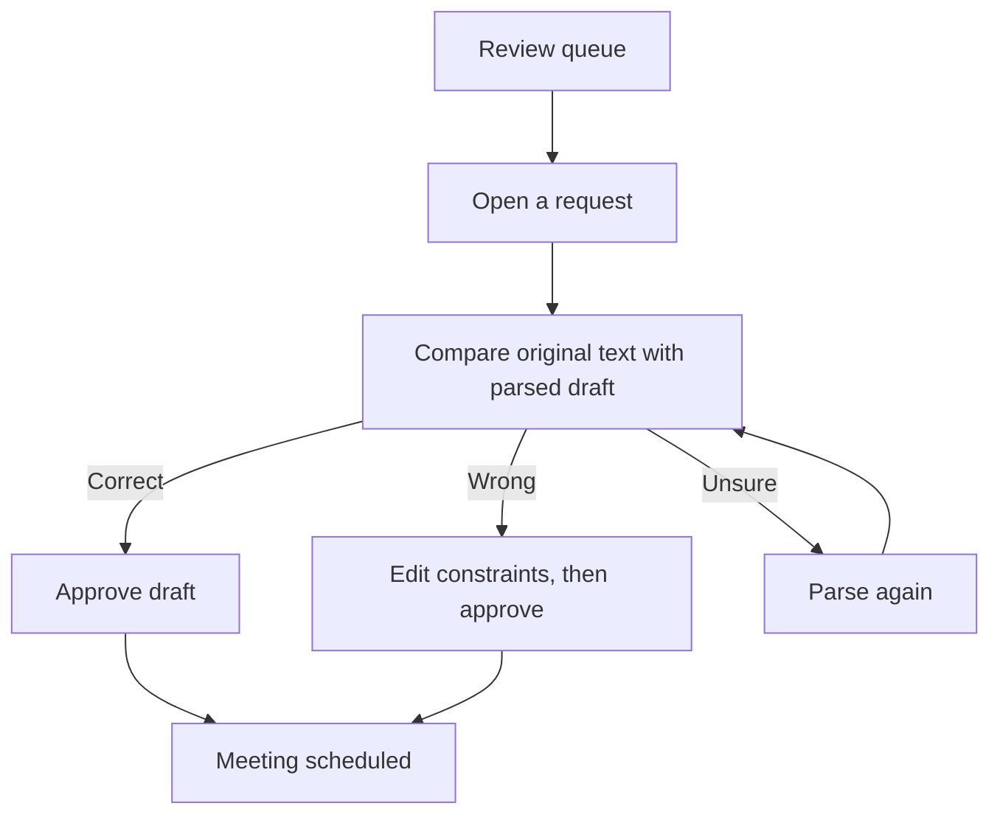
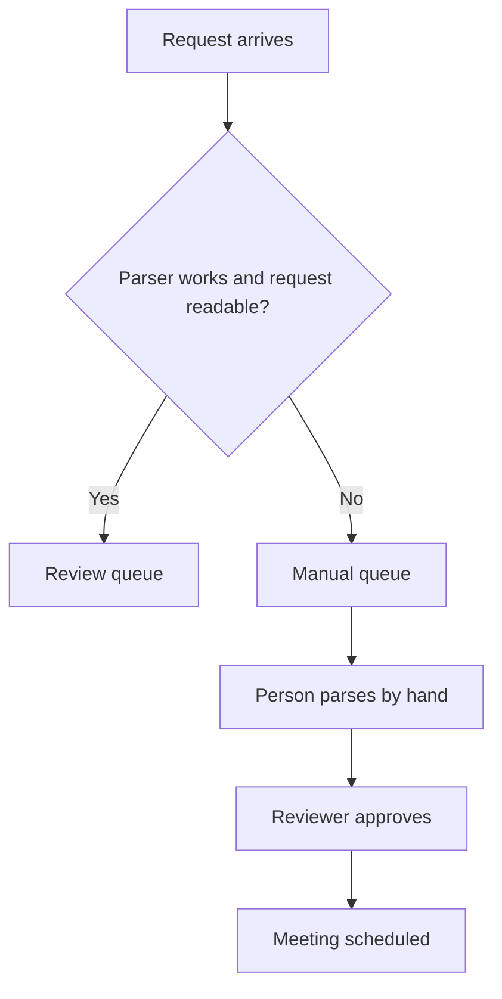
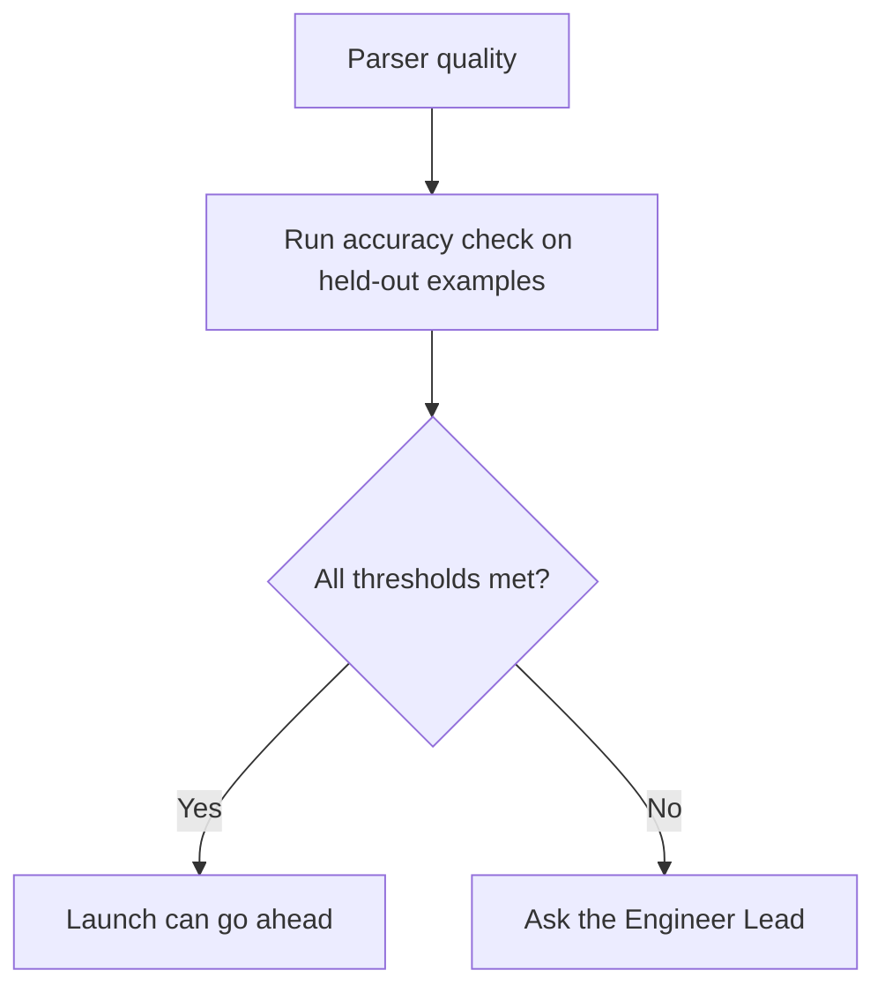

# Flows

## FLOW-001 Review a parsed request
**REQs**: REQ-001, REQ-002, REQ-003, REQ-004

## FLOW-002 Parser fails or cannot read a request
**REQs**: REQ-003, REQ-008

## FLOW-003 Check parser quality
**REQs**: REQ-005, REQ-006

